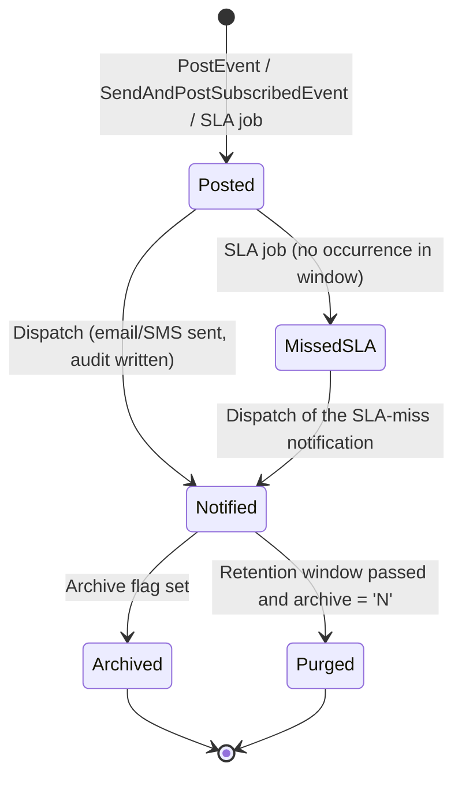
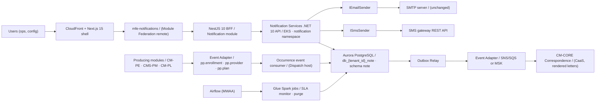
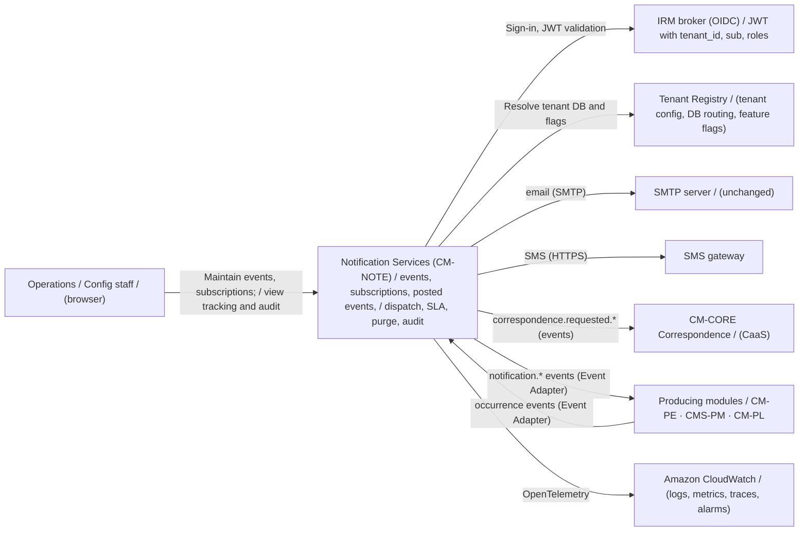
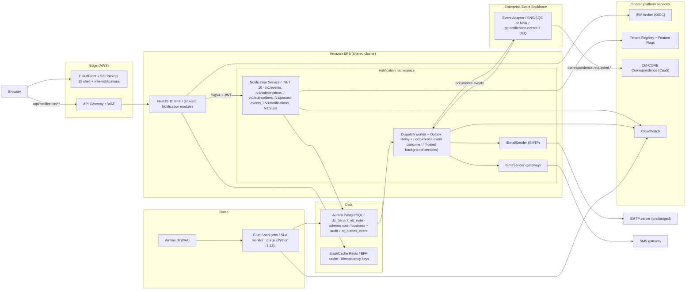

# Target State Technical Design: Notification Services (CM-NOTE)

Provider Plus Modernization · Notification Services module · Target State v1.0 · For sign-off · 5 November 2026

## Document Information [Added for spec generation]

| Item | Value |
| --- | --- |
| Module | Notification Services (CM-NOTE) |
| Legacy repository | `mms-cms-note-delivered-r30.2609` (its live folders `components/bas`, `components/ux`, `components/db`; `components/api`, `components/batch`, `components/eai`, `components/reports` are README stubs only and are not a source) |
| Source | `CURRENT-STATE-notification.html`, `Email_Sms_CurrentState.html`, `Notification_API_Endpoint_Guide.html`, `Notifications_Database_DeepDive.html`, `Notifications-Batch-Jobs-Deep-Dive.html`, `Notifications-UI-Deep-Dive-v2.html` (current state); `Proposed_Future_State_SMS_Email.html`, `ADR_Live_Document.txt`, `ARB-Provider-Plus-Summary.md` (target state) |
| Module path in the monorepo | `components/supporting-modules/notification/` (the screens and the BFF module live under `components/enrollment/`, Section 14) |
| Purpose of this file | The target state passed to spec generation (`--target-state`) for the Notification Services module |

This file follows the structure of `target-state-plan-management.md`. Its diagrams are Mermaid. Section 15 is
added for spec generation; it gives the deployables in the spec tool's terms, how the legacy code maps onto
them, and the points that need the architects' confirmation.


## 0. About This Document

This document is the single source for generating the Notification Services specifications. It states **what Notification Services must do** (Part I — Business) and **how it is built** (Part II — Technical), followed by the low level design (Appendices A – F).

Rules for using this document:

1.  **Behaviour comes from the legacy system.** The legacy `mms-cms-note` code is the source of the business behaviour to rebuild: event definitions, subscription matching, posted-event tracking, delivery, SLA monitoring and purging. Where this document states a rule, that rule applies; where it is silent, the legacy behaviour applies unchanged.
2.  **Interfaces and technology come from this document.** Legacy WCF, CoreWCF, Service Fabric hosting, ASP.NET MVC/Razor, SSRS correspondence generation, the legacy Oracle DAO and the console batch host are not reproduced; they are replaced by the components defined in Part II.
3.  **The contracts in Appendix F are authoritative** for request/response shapes, paths and operation ids. Part II §8.4 adds the endpoints that have no legacy equivalent.
4.  **The schema in Appendix B is authoritative** for tables. Tables listed without DDL mirror the legacy entity columns using the conventions of Appendix B §1.
5.  All examples use synthetic values.

------------------------------------------------------------------------

# PART I — BUSINESS

## 1. Purpose and Scope

### 1.1 Purpose

Notification Services lets platform modules (Provider Enrollment, Provider Management, Plan Management and the shared services) **define notification events**, **subscribe recipients** (email and SMS), **post event occurrences**, and have **notifications delivered** over email (SMTP) and SMS. It also performs **SLA monitoring** of scheduled events that fail to occur and **retention/purge** of aged tracking records. It keeps a full **delivery audit** of every message sent.

> Other modules decide **what happened** (an enrollment moved to screening, a provider was approved). Notification Services decides **who is told, over which channel, and whether it was delivered**, and keeps the record of it.

### 1.2 Capabilities in Scope

| **Capability** | **Description** |
|----|----|
| Event definitions | Named, subsystem-scoped notification events with a message template, category, SLA flag and a run schedule (day-of-week / day-of-month / expected run time) |
| Subscriptions | Recipient subscriptions to an event, matched by explicit event id or by subsystem / category / "event-name-contains" rule; per-subscription email and SMS channel selection |
| Subscribers | Reusable recipient records holding an email address and an SMS address |
| Posted events | Occurrences of an event ("event tracking"), posted by producers or by the SLA job, with a custom message and the resolved template message |
| Email delivery | Delivery over **SMTP**, kept exactly as current state (same server and configuration), behind an `IEmailSender` abstraction |
| SMS delivery | Delivery over the existing **SMS gateway REST API** (`X-API-Key` / `X-App-Name`), behind an `ISmsSender` abstraction |
| Recipient allow-listing | Recipient domain allow-list filtering (`ALLOWED_EMAIL_DOMAINS`) carried forward |
| SLA monitoring | Detects scheduled SLA events that did not post within their window and raises a "failed to occur as scheduled" notification |
| Retention / purge | Deletes aged, non-archived tracking records on a retention window |
| Delivery audit | Per-message and per-recipient audit (`from`, `subject`, `message`, `to`, `mail type`, timestamps), queryable through an audit endpoint |

### 1.3 Ownership Boundary

| **Correspondence Management (CM-CORE) owns** | **Notification Services (CM-NOTE) owns** |
|----|----|
| Templated **correspondence letters / documents** (formerly SSRS `ReportExecution2005.asmx`), rendered through CaaS (ADR-039, ADR-019/021) | Notification event catalogue |
| Notice templates in S3, tenant template selection | Subscriptions and subscribers |
| Document fulfilment and mail channel | Posted-event tracking and SLA monitoring |
|  | Email (SMTP) and SMS delivery of event notifications |
|  | Delivery audit |

Notification Services generates no SSRS/rendered correspondence documents itself. Where a notification needs a rendered letter, Notification Services raises the event and **CM-CORE Correspondence Service** produces and fulfils the document (ADR-039). Notification Services never writes provider, plan or enrollment business data.

### 1.4 Out of Scope

- Authoring the business meaning of an event (owned by the producing module).
- Correspondence **document rendering** and physical mail fulfilment (CM-CORE Correspondence Service / CaaS, ADR-039).
- Member/beneficiary communications and any PHI; the platform handles provider PII only (ARB §8.1).
- The legacy **CQRS event store** (`COMMITS`, `SNAPSHOTS`, `EVENT_AUDIT`) and aggregate/projection machinery — not reproduced (ADR-041).

### 1.5 Business Objects

| **Object** | **Source** | **Purpose** |
|----|----|----|
| Event | Notification Services (seeded + maintained) | A named notification trigger with schedule and SLA metadata |
| Subscription | Notification Services | Binds a subscriber to an event (by id or match rule) and selects channels |
| Subscriber | Notification Services | A reusable recipient (email address, SMS address) |
| Posted Event (tracking) | Producers (events) or the SLA job | A recorded occurrence of an event, awaiting or having completed notification |
| Notification Audit | Notification Services | The record of a sent message |
| Receiver Audit | Notification Services | The per-recipient record (to / cc / bcc, mail type) of a sent message |

Relationship chain: `Event → Subscription → Subscriber`, and `Event → Posted Event → Notification Audit → Receiver Audit`.

## 2. Notification Dispatch

### 2.1 Subscription Matching

When an event is posted, recipients are resolved from active subscriptions using the legacy three-rule match (any rule matching includes the subscriber), evaluated against the posted event's `event id`, `subsystem`, `category` and `event name`:

| **Precedence** | **Match rule** |
|----|----|
| 1 | Exact `event_id` subscription |
| 2 | `subsystem` + `category` subscription |
| 3 | `event_name_contains` text match |

A subscriber may be reached once per posted event even if more than one rule matches (de-duplicated by subscriber and channel). Only **Active** subscriptions, subscribers and events take part.

### 2.2 Channel Selection

- A subscription carries an email address and, when `send_sms = true`, an SMS address.
- Email is delivered over **SMTP** through `IEmailSender`; SMS is delivered over the **SMS gateway** through `ISmsSender`.
- Recipient email addresses are filtered against the **allow-list** (`ALLOWED_EMAIL_DOMAINS`, env/secret-sourced) before send; a recipient outside the allow-list is dropped and the drop is logged. If the allow-list removes every recipient, the send is skipped (no partial-send failure).
- Per-tenant **feature flags** (ADR-018/ADR-039) may enable or disable a channel for a tenant without redeployment.

### 2.3 Idempotency of Dispatch

- Each posted event is notified **once**: the dispatch marks `notification_created` on the tracking row in the same transaction that records the audit, so a re-run never re-sends.
- The dispatch worker is idempotent on `posted_event_id`; a replayed trigger returns the original result.

## 3. Notification Lifecycle

### 3.1 Lifecycle-Governed Records

The lifecycle applies to **posted events** (event tracking). **Events, subscriptions and subscribers** keep their legacy maintenance behaviour (add, update, validate, soft-delete / inactivate) and are not governed by the posted-event lifecycle.

### 3.2 Posted-Event Statuses

| **Status** | **Actor** | **Meaning** |
|----|----|----|
| Posted | Producer / SLA job | Occurrence recorded in tracking; not yet notified (`is_notified = false`) |
| Notified | Dispatch worker | Notification sent; `notification_created` set |
| MissedSLA | SLA job | Marked when a scheduled SLA event did not occur in its window (`missed_sla`) |
| Archived | Retention | Flagged `archive = 'Y'`; excluded from purge |
| Purged | Retention job | Aged, non-archived tracking row deleted |

### 3.3 Transitions



Lifecycle rules:

1.  A posted event is notified exactly once (§2.3); the notify mark and the audit write are in one transaction.
2.  Soft-deleted / inactive events, subscriptions and subscribers are never selected for dispatch.
3.  Records are never hard-deleted except by the retention/purge job (§3.4); history is preserved in the audit tables.
4.  Every delivery (success or failure) writes a `nt_notification_audit` row and its `nt_receiver_audit` rows.
5.  A scheduled SLA event with no occurrence within `expected run time + grace` is posted as a "failed to occur as scheduled" event and then dispatched.

### 3.4 Retention and Purge

| **Aspect** | **Rule** |
|----|----|
| Definition | Scheduled deletion of aged tracking rows |
| Window | Rows older than `DaysToKeepBeforePurge` (tenant setting) |
| Exclusion | Rows with `archive = 'Y'` are kept |
| Audit | Delivery audit (`nt_notification_audit`, `nt_receiver_audit`) is **not** purged; it is retained 7 years (ADR-016) |

### 3.5 Phase 1 Screens

| **Screen** | **Type** | **Backing data** |
|----|----|----|
| Event Notification Search / Tracking | Rebuilt from legacy | `nt_event`, `nt_event_tracking` through the query endpoints |
| Event (Service) Configuration — add / edit / inactivate | Rebuilt from legacy | `nt_event` |
| Subscription Details — add / edit | Rebuilt from legacy | `nt_event_subscription` |
| Subscriber Search — add / edit / inactivate | Rebuilt from legacy | `nt_subscriber` |
| Delivery Audit | New | `nt_notification_audit`, `nt_receiver_audit` |
| Dispatch / DLQ status | New | Outbox / dispatch status and the consumer DLQ |

Dropdown values (subsystem, category, run-schedule, channel) come from DataLists / Tenant Registry; they are never hard-coded.

## 4. Business Rules

### 4.1 Rules Placement

- Notification Services has **no InRule dependency**. Structural rules (required fields, valid enums, address format, match evaluation, schedule evaluation, allow-list filtering, idempotency) are implemented in the owning service's `Domain/` folder.
- Where a producing module's event requires conditional content or routing, that logic stays with the producer; Notification Services only matches subscriptions and delivers.

### 4.2 Business Rules Catalogue

Each rule is implemented in exactly one service's `Domain/` folder, with its id in a comment and in the name of at least one test.

| **ID** | **Rule** | **Enforced in** |
|----|----|----|
| BR-001 | An event requires a non-empty `event_name` and `subsystem` | Notification Service |
| BR-002 | An event's run schedule / SLA fields are internally consistent (a scheduled SLA event has a run time) | Notification Service |
| BR-003 | A subscription must reference a valid subscriber and either an `event_id` or a match rule (subsystem/category/name-contains) | Notification Service |
| BR-004 | A subscriber requires a valid email address; an SMS address is required when any subscription sets `send_sms = true` | Notification Service |
| BR-005 | Email and SMS addresses are validated for format before persistence and before send | Notification Service |
| BR-006 | Only Active events, subscriptions and subscribers take part in dispatch | Dispatch |
| BR-007 | Subscription matching follows the three-rule precedence (§2.1); a subscriber is reached once per posted event per channel | Dispatch |
| BR-008 | Recipient email addresses are filtered against `ALLOWED_EMAIL_DOMAINS`; excluded recipients are dropped and logged | Dispatch |
| BR-009 | If the allow-list removes all recipients, the send is skipped (not an error) | Dispatch |
| BR-010 | A posted event is notified exactly once; the notify mark and audit write are one transaction | Dispatch |
| BR-011 | Every send (success or failure) writes `nt_notification_audit` and `nt_receiver_audit` | Dispatch |
| BR-012 | A scheduled SLA event with no occurrence in its window is posted as "failed to occur as scheduled" and dispatched | SLA job |
| BR-013 | Retention deletes only tracking rows older than `DaysToKeepBeforePurge` with `archive = 'N'` | Retention job |
| BR-014 | Delivery audit is retained 7 years and is never purged | Retention job |
| BR-015 | Soft-delete / inactivate preserves history; records are not hard-deleted outside retention | All services |
| BR-016 | Data of one tenant is never visible to another tenant | All services |
| BR-017 | Tenant and user come only from the JWT; any tenant field in a request body is ignored | All services |
| BR-018 | Exact duplicate event / subscriber records are rejected | Notification Service |
| BR-019 | Dispatch is idempotent on `posted_event_id`; consumers idempotent on `event_id` | Dispatch |
| BR-020 | A channel disabled by a tenant feature flag is not used | Dispatch |

### 4.3 Inbound Events Consumed

| **Event from other modules** | **Notification Services behaviour** |
|----|----|
| `enrollment.workflow.*` / `provider.*` / `plan.*` occurrence events (producers) | Post a tracking row for the mapped notification event (`nt_event_tracking`), then dispatch to matched subscribers |
| `correspondence.requested.*` (where a notification needs a rendered letter) | Publish/relay to CM-CORE Correspondence Service; Notification Services does not render the document (ADR-039) |

The 15 seeded `ProviderEnrollment` (`PEWrkflw*`) events of the legacy `SP78_01_EVENT_INSERT.sql` are migrated as event definitions and continue to drive enrollment notifications.

### 4.4 Reference Data

Notification Services holds no national reference data. Subsystem, category, run-schedule and channel value lists come from the shared DataList / Tenant Registry surfaces.

### 4.5 Workflows and Operations

| **Workflow** | **Domain operation** |
|----|----|
| WF-01 Define / update event | `CreateEvent`, `UpdateEvent`, `InactivateEvent` |
| WF-02 Create / update subscriber | `CreateSubscriber`, `UpdateSubscriber`, `InactivateSubscriber` |
| WF-03 Create / update subscription | `CreateSubscription`, `UpdateSubscription` |
| WF-04 Post event occurrence | `PostEvent`, `SendAndPostSubscribedEvent` |
| WF-05 Dispatch notifications | `DispatchPostedEventNotifications` (consumer / worker) |
| WF-06 Send ad-hoc email | `SendEmail` |
| WF-07 Send ad-hoc SMS | `SendSms` |
| WF-08 SLA monitoring | `ProcessScheduledEventSla` (batch) |
| WF-09 Retention / purge | `PurgeTrackedEvents` (batch) |
| WF-10 Query delivery audit | `GetNotificationAudit` |

------------------------------------------------------------------------

# PART II — TECHNICAL

## 5. Architecture Overview

### 5.1 Architecture Classification

**CRUD Architecture (no CQRS, ADR-041) + Single Aurora PostgreSQL Datastore (Database-per-Tenant, ADR-012) + Event-Driven Notification Dispatch + Pluggable Delivery Channels (SMTP email behind `IEmailSender`; SMS gateway behind `ISmsSender`) + Transactional Outbox + Event Adapter Eventing (Amazon SNS/SQS or Amazon MSK, ADR-002) + Scheduled SLA/Purge jobs (AWS Glue Spark + Airflow/MWAA, ADR-010) + NestJS 10 BFF + .NET 10 APIs (ADR-022, ADR-004).**

- Pure CRUD: the service creates, reads, updates and soft-deletes records in a single Aurora PostgreSQL datastore (one tenant database, schema `note`) through Npgsql repositories. The legacy CQRS aggregate / projection / event-store machinery is **not** reproduced (ADR-041).
- Delivery is **event-driven**: producing modules publish occurrence events; Notification Services consumes them, posts tracking rows and dispatches to matched subscribers.
- **SMTP is kept exactly as current state** (same server and configuration) behind `IEmailSender`; SMS keeps the existing gateway behind `ISmsSender`. Only the delivery plumbing is swapped (`Proposed_Future_State_SMS_Email.html`).
- Every state change writes an outbox row in the same transaction; an Outbox Relay publishes it through the Event Adapter after commit.
- No synchronous calls to other domains. CM-CORE Correspondence, InRule-free; Tenant Registry and Feature Flags are shared platform services (ADR-018, ADR-025).
- **No inbound access from external systems.** External systems never call Notification Services.

### 5.2 Technology Stack

| **Layer** | **Technology** |
|----|----|
| Frontend | Next.js 15.5, React 19.2, TypeScript 5.6, Module Federation (`@module-federation/nextjs-mf`), `@mms/ui-kit`, Tailwind CSS 3.4, TanStack React Query 5, React Hook Form 7 + Zod 3, OpenTelemetry JS, Jest + React Testing Library, Playwright, Node ≥ 20 |
| BFF | NestJS 10.4 on Express, TypeScript 5.6, `@nestjs/swagger`, class-validator, class-transformer, jose (JWT), AWS SDK v3 + `aws4` (SigV4), Redis 4.7 client (Amazon ElastiCache), OpenTelemetry Node SDK, Jest + Supertest |
| Domain API | .NET 10 (`net10.0`), ASP.NET Core Web API (controllers), Swashbuckle (Swagger/OpenAPI), **Npgsql** with the Repository Pattern and SQL-based data access, Event Adapter (`hpp_events`), **`IEmailSender`** (MailKit or `System.Net.Mail.SmtpClient`) and **`ISmsSender`** (`IHttpClientFactory`), OpenTelemetry .NET; build settings: `Nullable` enabled, `ImplicitUsings` enabled, `TreatWarningsAsErrors`, analyzers at `latest-recommended` |
| Email transport | **SMTP** — unchanged server / port / credentials / `FromAddress`; client library swappable behind `IEmailSender` (MailKit recommended, `SmtpClient` acceptable for lift-and-shift) |
| SMS transport | Existing **SMS gateway REST API** over HTTPS (`X-API-Key`, `X-App-Name`), via `IHttpClientFactory` behind `ISmsSender` |
| Schema migrations | **Alembic** (authoritative, ADR-007/ADR-013), applied per tenant database |
| Database | Amazon Aurora PostgreSQL, Database-per-Tenant (ADR-012) |
| Messaging | Enterprise Event Backbone through the Event Adapter; transports **Amazon SNS/SQS** and **Amazon MSK (Kafka)** (ADR-002) |
| Batch | AWS Glue Spark (Python 3.12), Apache Airflow (Amazon MWAA), Amazon S3 (ADR-004, ADR-010) |
| Runtime | Amazon EKS Auto Mode (shared cluster, `notification` namespace), AWS API Gateway + AWS WAF, KEDA; frontend on Amazon S3 + CloudFront (ADR-005, ADR-011) |
| Identity | **IRM broker** — OIDC identity broker (not the identity provider), federating to state IdPs and the Gainwell IdP (Microsoft Entra ID); issues JWTs with `tenant_id`, `sub` and `roles`; FAPI 2.0 (Authorization Code + PKCE + PAR) (ADR-014) |
| Observability | OpenTelemetry → Amazon CloudWatch (logs, metrics, traces); PII redacted by `hpp_observability` (ADR-016) |
| Delivery | GitHub Actions, Terraform, Docker + Amazon ECR, AWS SAM / CodeDeploy canary + linear, JFrog Artifactory (ADR-015) |

> **Open item (architects):** ADR-039 states that platform notification/correspondence **email** is fulfilled by the CM-CORE Correspondence Service through **CaaS**. The provided `Proposed_Future_State_SMS_Email.html` requires **keeping SMTP** in the Notification module. This document follows the proposal (SMTP behind `IEmailSender`) and treats CaaS fulfilment as an alternative delivery provider selectable per tenant by feature flag. See §15.4.

### 5.3 Request and Event Flow

```text
Producing module (CM-PE / CMS-PM / CM-PL)
    ↓  occurrence event (Event Adapter)
Notification Services .NET 10 API (EKS, notification namespace)
    ├── post tracking row + outbox row (one Aurora transaction)
    ├── Dispatch worker → IEmailSender → SMTP server (unchanged)
    └── Dispatch worker → ISmsSender  → SMS gateway REST API
    ↓
Aurora PostgreSQL db_{tenant_id}_note, schema note (business rows + audit + outbox)
    ↓
Outbox Relay → Event Adapter → SNS/SQS or MSK   (notification.* events)
```



### 5.4 C1 — System Context



| **External actor / system** | **Interaction with Notification Services** |
|----|----|
| Ops / config staff | Use `mfe-notifications` in the browser through the NestJS BFF |
| IRM broker | Brokers sign-in to the state IdP or Gainwell IdP; issues the JWT used on every call (ADR-014) |
| Tenant Registry | Resolves the tenant database, schema version and feature flags (ADR-007) |
| Producing modules | Publish occurrence events consumed by Notification Services; never called synchronously (ADR-002) |
| SMTP server | Receives email, unchanged server / config |
| SMS gateway | Receives SMS over HTTPS REST |
| CM-CORE Correspondence | Renders and fulfils letters when a notification needs a document (ADR-039) |
| CloudWatch | Receives all telemetry; raises alarms (ADR-016) |

### 5.5 C2 — Container View



| **Container** | **Technology** | **Responsibility** |
|----|----|----|
| Shell + `mfe-notifications` | Next.js 15, React 19, Module Federation, S3 + CloudFront | Notification admin / tracking / audit screens |
| NestJS BFF (shared) | NestJS 10, Express, jose, Redis, OpenTelemetry | Auth, aggregation, view models, orchestration, errors |
| Notification Service | .NET 10 ASP.NET Core, Npgsql | Events, subscriptions, subscribers, posted events, dispatch, audit; hosts the occurrence-event consumer, Dispatch worker and Outbox Relay |
| `IEmailSender` / `ISmsSender` | MailKit / `SmtpClient`; `IHttpClientFactory` | Pluggable email (SMTP) and SMS (gateway) delivery |
| Tenant database | Aurora PostgreSQL `db_{tenant_id}_note`, schema `note` | All tenant operational data, audit, outbox |
| Redis | Amazon ElastiCache | BFF response cache, idempotency keys |
| Event Backbone | Event Adapter over SNS/SQS or MSK | Inbound occurrence events and outbound `notification.*` events, DLQs |
| Batch | S3, Airflow (MWAA), Glue Spark | SLA monitoring and retention/purge jobs |

## 6. Frontend

- Notification screens are the Module Federation remote **`mfe-notifications`**, loaded at runtime by the shared Next.js shell alongside the other remotes. One deployment serves all tenants (ADR-011).
- The remote exposes `./App`, mounted by the shell under `/notifications/[[...slug]]` behind `RequireAuth`; sub-routes are internal to the remote.
- The remote calls **only** the NestJS BFF (`/api/notification/**`); it never calls the .NET API directly. Remotes never import each other; cross-remote interaction uses the shell event bus.
- Server state with TanStack React Query; forms with React Hook Form + Zod; shared components from `@mms/ui-kit`; styling with Tailwind CSS.
- Errors are RFC 7807 ProblemDetails; `400` shows field errors from `errors`.
- Static export to S3 + CloudFront with content-hashed `remoteEntry.js`.
- WCAG 2.2 AA and Section 508; axe-core and Lighthouse CI on every pull request; Playwright end-to-end tests (ADR-032).

## 7. BFF

### 7.1 Responsibilities

Notification Services uses the **shared NestJS 10 BFF** and adds a **Notification module** to it. There is no separate Notification BFF deployment. The BFF has no database access (ADR-011).

| **\#** | **Responsibility** | **What the Notification module does** |
|----|----|----|
| 1 | Authentication & Authorization | Validates the JWT with jose (IRM broker JWKS); propagates `sub`, `roles`, `tenant_id`; CSRF guard on mutating calls; checks scopes before forwarding (Appendix D) |
| 2 | API Aggregation | Combines event, subscription, subscriber and audit responses into one screen response |
| 3 | View Model Transformation | Shapes Appendix F responses into screen view models |
| 4 | Orchestration | Coordinates multi-step operations (e.g. create subscriber → create subscription); business rules stay in the domain service |
| 5 | Error Handling | RFC 7807 ProblemDetails, correlation id on every request and response, errors reported through OpenTelemetry |

Pipeline: CorrelationIdMiddleware → SessionMiddleware (tenant resolution) → CsrfGuard / JwtAuthGuard → controller → ProblemDetailsExceptionFilter. Resiliency: retry with exponential backoff (3 attempts), circuit breaker per downstream client, 5 s timeout, rate limiting. Redis response cache with tenant-prefixed keys for event / DataList lookups.

### 7.2 Routes

| **BFF route** | **Methods** | **Forwards to** |
|----|----|----|
| `/api/notification/events/**` | GET, POST, PATCH | Notification Service `/v1/events` |
| `/api/notification/subscriptions/**` | GET, POST, PATCH | Notification Service `/v1/subscriptions` |
| `/api/notification/subscribers/**` | GET, POST, PATCH | Notification Service `/v1/subscribers` |
| `/api/notification/posted-events/**` | GET, POST | Notification Service `/v1/posted-events` |
| `/api/notification/notifications/**` | POST | Notification Service `/v1/notifications` (send email / SMS) |
| `/api/notification/audit/**` | GET | Notification Service `/v1/audit` |

### 7.3 Contract Governance

- Every domain API has an OpenAPI 3.0 document in `api-specification/` (Appendix F), written before implementation (ADR-033).
- The BFF uses TypeScript clients generated from those documents; the .NET service implements them.
- CI runs an OpenAPI diff on every pull request; a breaking change fails the build unless the path version changes (`/v1/` → `/v2/`). Consumer contract tests run in addition (ADR-015, ADR-029).

## 8. Domain Services

### 8.1 Services

| **Service** | **Base routes** | **Owns** | **Model** |
|----|----|----|----|
| Notification Service | `/v1/events`, `/v1/subscriptions`, `/v1/subscribers`, `/v1/posted-events`, `/v1/notifications`, `/v1/audit` | Event catalogue, subscriptions, subscribers, posted-event tracking, dispatch, email/SMS delivery, delivery audit | CRUD + event-driven dispatch |

The single service: .NET 10 ASP.NET Core Web API on EKS (`notification` namespace), Npgsql repositories against the tenant database, transactional outbox, Event Adapter, OpenTelemetry. It hosts three background services: the **occurrence-event consumer**, the **Dispatch worker**, and the **Outbox Relay**.

| **Service** | **Events published** | **Events consumed** |
|----|----|----|
| Notification | `notification.event.updated.v1`, `notification.subscription.updated.v1`, `notification.posted.v1`, `notification.dispatched.v1`, `notification.delivery_failed.v1`, `notification.sla_missed.v1`, `correspondence.requested.v1` | `enrollment.workflow.*`, `provider.*`, `plan.*` occurrence events |
| Batch (Glue) | `notification.purge.completed.v1`, `notification.sla_scan.completed.v1` | — |

### 8.2 API Standards

- URI versioning (`/v1/...`); contract-first OpenAPI 3.0 (ADR-004 §4.4).
- `Authorization: Bearer <JWT>` on every call; **tenant and user come only from the JWT**. Any `tenantId`, `TenantId` or `Requestor` field in a request body is ignored (ADR-023).
- `X-Correlation-Id` optional inbound, always returned.
- `X-Idempotency-Key` required on every endpoint that creates or changes state; duplicates within 24 h return the original result (Redis).
- Errors are `application/problem+json` (RFC 7807) with `errors: { "<field>": ["..."] }` for validation.
- Request validation runs before business logic.

### 8.3 Legacy Interface Replacement

| **Legacy surface** | **Target** |
|----|----|
| `UX.Services` Web API 2 controllers, `UX.Providers` WCF proxies, `UX.Presentation` MVC/Razor | NestJS BFF Notification module + `mfe-notifications` |
| `INotificationService` (WCF / CoreWCF / Service Fabric) | `/v1/events`, `/v1/subscriptions`, `/v1/subscribers`, `/v1/posted-events`, `/v1/notifications` REST (ADR-022) |
| `INotificationCommandService` / `INotificationQueryService` (CQRS WCF) | Collapsed into the single CRUD Notification Service; command/query split not reproduced (ADR-041) |
| `IEventDistribution` / `NotificationEventService` | Occurrence events through the Event Adapter (§10); the in-process distributed-event framework is retired |
| `CorrespondenceNotificationCommandHandler` + `SSRSProvider` (SSRS `ReportExecution2005.asmx`) | Letter rendering moves to **CM-CORE Correspondence Service / CaaS** (ADR-039, ADR-019/021); Notification Services raises `correspondence.requested.v1` and sends the covering email over SMTP |
| `HPP.NotificationServices.Main` (Service Fabric host) + CoreWCF host | A single containerized .NET 10 API on EKS Auto Mode (ADR-005, ADR-022) |
| `HPP.NotificationServices.ConsoleApp` batch jobs (notify / SLA / purge) | Dispatch becomes an in-service worker; SLA monitoring and purge become Glue Spark jobs on an Airflow DAG (§11) |
| `OracleDAOBase<T>` ADO.NET stored-proc path, EF Core `NotificationsDbContext`, dual SQL Server/Oracle | Parameterized PostgreSQL in Npgsql repositories (ADR-012) |
| `SmtpClient` in Library `NotificationService` | `IEmailSender` over SMTP (MailKit or `SmtpClient`) — same server/config (`Proposed_Future_State_SMS_Email.html`) |
| `SendSmsNotification` (`new HttpClient()` + `Task.Run(...).Result`, `#if DEBUG` cert bypass) | `ISmsSender` using `IHttpClientFactory`, async, no cert bypass |

### 8.4 Endpoints Without a Legacy Equivalent

These endpoints follow §8.2; their contract is Appendix F.

| **Method** | **Path** | **Purpose** |
|----|----|----|
| GET | `/v1/audit?eventId=&from=&to=` | Query delivery audit (`nt_notification_audit` ⋈ `nt_receiver_audit`) |
| GET | `/v1/posted-events/{id}/dispatch-status` | Dispatch / delivery status for a posted event |
| POST | `/v1/notifications/email` | Send an ad-hoc email (replaces `SendEmail`) |
| POST | `/v1/notifications/sms` | Send an ad-hoc SMS (replaces `SendSmsText`) |
| POST | `/v1/posted-events` | Post an occurrence (replaces `PostEvent` / `SendAndPostSubscribedEvent`) |
| GET | `/v1/dlq` | Occurrence-consumer dead-letter view |
| POST | `/v1/dlq/{eventId}:replay` | Replay a dead-lettered occurrence event |

### 8.5 Security

- Every request carries a JWT; the BFF validates user sessions and the service validates the JWT again. External systems have no inbound route to Notification Services (ADR-031).
- Service-to-service calls use IAM-signed requests (SigV4) over the internal network; pods use EKS Pod Identity with least-privilege IAM roles; secrets come from AWS Secrets Manager (ADR-009, ADR-031).
- **All legacy hardcoded secrets are removed** (ADR-031, `Proposed_Future_State_SMS_Email.html` §7): `SmtpPassword`, `SmsAccountToken`, the Azure SQL tenant-config password, the Azure Storage key in log4net, the App Insights key, the `FLDDIEdi` decryption key and the endpoint certificate thumbprint move to Secrets Manager / are retired.
- The tenant database is selected by the `ConnectionRouter` (`hpp_db`) from the JWT `tenant_id`; no request can reach another tenant's database.
- Encryption at rest with per-tenant AWS KMS keys (Aurora and S3); TLS 1.3 in transit (TLS 1.2 only for legacy inbound); PII (email, SMS address, recipient) is masked in logs and never returned in errors (ADR-016, ADR-031).
- Scopes and roles are in Appendix D.

### 8.6 Resiliency

| **Pattern** | **Implementation** |
|----|----|
| Transactional outbox | Business/audit rows and the `nt_outbox_event` row in one Npgsql transaction |
| Idempotency | `X-Idempotency-Key` (Redis, 24 h); dispatch idempotent on `posted_event_id`; consumers idempotent on `event_id` |
| Retry + circuit breaker | BFF → API; Dispatch → SMTP / SMS gateway (`hpp_resilience`) |
| Delivery failure handling | A failed send writes a `delivery_failed` audit row and a `notification.delivery_failed.v1` event; retried per policy |
| Dead-letter | The occurrence consumer has a DLQ (§10.2); alarm on depth \> 0 (ADR-037) |
| Health checks | `/health/live`, `/health/ready` |

## 9. Persistence

### 9.1 Tenancy and Schema

- **Database-per-Tenant** on a shared Amazon Aurora PostgreSQL Multi-AZ cluster: each tenant has `db_{tenant_id}_note` (ADR-012).
- One schema **`note`** per tenant database holds all tenant business data, audit and outbox. It is the single datastore for every API operation.
- The service connects with one tenant-scoped database credential resolved by the `ConnectionRouter` (`hpp_db`) from the Tenant Registry on every call.
- Notification Services has **no shared `db_shared` tables** (it holds no national reference data).
- Table names use the `nt_` prefix. DDL is in Appendix B.

### 9.2 Operational Tables

| **Area** | **Tables** |
|----|----|
| Platform | `nt_outbox_event`, `nt_dispatch_status` |
| Events | `nt_event` (from legacy `EVENT`) |
| Tracking | `nt_event_tracking` (from legacy `EVENT_TRACKING`) |
| Subscriptions | `nt_event_subscription` (from legacy `EVENT_SUBSCRIPTION`) |
| Subscribers | `nt_subscriber` (from legacy `SUBSCRIBER`) |
| Audit | `nt_notification_audit` (from legacy `NOTIFICATION_AUDIT`), `nt_receiver_audit` (from legacy `RECEIVER_AUDIT`) |

Legacy → target table mapping (full column mapping in Appendix B §4):

| **Legacy (`UA3_NOTIFICATIONS`)** | **Target (`note`)** | **Notes** |
|----|----|----|
| `EVENT` | `nt_event` | `Y/N` flags → `boolean`; IDs → `uuid`; audit columns standardised |
| `EVENT_TRACKING` | `nt_event_tracking` | `is_notified`, `missed_sla`, `archive`, `notification_created`, `process_run` |
| `EVENT_SUBSCRIPTION` | `nt_event_subscription` | `send_sms boolean`, `event_name_contains_txt`, `category_cd` |
| `SUBSCRIBER` | `nt_subscriber` | `email_txt`, `sms_address_txt`, `is_active` |
| `NOTIFICATION_AUDIT` | `nt_notification_audit` | `from_address`, `subject`, `message`, `created_at`, `sent_at` |
| `RECEIVER_AUDIT` | `nt_receiver_audit` | `audit_id` FK, `to_address`, `mail_type`, `created_at` |

The Oracle `PKG_SYS_EVENTING.CREATE_NOTIFICATION_AUDIT` PL/SQL procedure is replaced by a repository method that inserts the audit row and its per-recipient rows (To/CC/BCC) in one transaction. The dual SQL Server / Oracle data path and `OracleDAOBase` are retired.

Every record carries `created_at`, `created_by`, `updated_at`, `updated_by`; soft-deletable records carry `is_active`. Keys are `uuid` (`gen_random_uuid()`).

### 9.3 Data Access

- The service has Npgsql repositories (Repository Pattern) with explicit SQL; a unit of work owns one Npgsql connection and transaction per write request.
- The outbox row and audit rows are inserted by the same transaction as the business change.
- Every SQL statement is parameterized; sortable and filterable fields map to an allow-list of columns.

### 9.4 Schema Migrations

- **Alembic** is the authoritative schema migration mechanism (ADR-007, ADR-013). Revisions live in `components/supporting-modules/notification/db/notification-service/` and run through the shared Alembic runner in the monorepo `db/` folder.
- Migrations are applied per tenant database by the deployment pipeline; a failure blocks only that tenant. The schema version per tenant is recorded in the Tenant Registry.
- Every migration is backward compatible with the previous application version (expand, then contract).

### 9.5 Transactional Outbox

Business/audit entities and outbox records are persisted within the same database transaction. After commit, the **Outbox Relay** (a hosted background service in the API host) reads unpublished `nt_outbox_event` rows, publishes them through the Event Adapter on the configured transport, and sets `published_at`. Failed publications are retried. Relays claim rows with `SELECT … FOR UPDATE SKIP LOCKED`.

### 9.6 Audit

- `nt_notification_audit` and `nt_receiver_audit` record every send (success and failure) in the same transaction as the dispatch.
- Delivery audit is retained **7 years**; pgAudit and CloudTrail write to S3 Object Lock (WORM) (ADR-016).
- PII in audit (email, SMS address) is encrypted at rest and masked in logs.

### 9.7 Data Migration and Cutover

- **Sources:** the legacy SQL Server database and, for Oracle tenants, the legacy Oracle `UA3_NOTIFICATIONS` schema. Each tenant is migrated from the engine it runs in production.
- **One-time ETL** (AWS DMS + scripts, ADR-013) into the `nt_*` tables using the mapping in Appendix B §4; the 15 seeded `PEWrkflw*` events are migrated as event definitions.
- **Reconciliation:** row counts, keys and audit records per tenant; differences are recorded and resolved before cutover.
- **Parallel run:** legacy and target run side by side for one full business cycle; exit requires delivery parity (≥ 98% at Gate 3, ADR-029), business sign-off and operations sign-off.
- **Cutover:** final delta load, reconciliation sign-off, producers switched to events, legacy set read-only. No dual-write after cutover.

## 10. Eventing

### 10.1 Event Adapter

All cross-domain integration uses the **Enterprise Event Backbone** through the **Event Adapter** (`hpp_events`), the same adapter as Enrollment. The adapter supports two transports, **Amazon SNS/SQS** and **Amazon MSK (Kafka)**; the transport is environment configuration, so domain code is identical on both (ADR-002).

```text
Occurrence event (pp.enrollment / pp.provider / pp.plan) → Event Adapter → occurrence consumer
    → Aurora (nt_event_tracking + nt_outbox_event) → Dispatch worker → SMTP / SMS gateway
    → Outbox Relay → Event Adapter → pp.notification.events (+ DLQ) → consumers (incl. CM-CORE Correspondence)
```

### 10.2 Transport Details

| **Concern** | **Amazon SNS/SQS** | **Amazon MSK (Kafka)** |
|----|----|----|
| Notification topic | SNS `pp-notification-events` (logical `pp.notification.events`) | `pp.notification.events` |
| Occurrence topics consumed | SQS queues subscribed to `pp-enrollment-events`, `pp-provider-events`, `pp-plan-events` | Consumer groups on `pp.enrollment.events`, `pp.provider.events`, `pp.plan.events` |
| Ordering | Not guaranteed; consumers idempotent | Partition key `tenant_id` + `aggregate_id` |
| Dead letter | SQS DLQ after 3 receives; redrive | DLQ topic `notification.dlq.v1`; replay |
| KEDA scaling signal | SQS queue depth | Consumer lag |

### 10.3 Event Rules

- Envelope on every event: `tenant_id`, `event_name`, `event_version`, `event_id`, `occurred_at`, `correlation_id`, `trace_id`, `producer`, `payload`, `metadata` (Appendix C), per ADR-002.
- `tenant_id` comes from the JWT / event header, never from the payload; topics are environment-scoped, not tenant-scoped.
- Event names follow `<domain>.<stream>.<action>.<version>`.
- Payloads carry identifiers and changed business fields only; no PII in the envelope (addresses stay in the tenant DB and audit).
- Schemas are registered in AWS Glue Schema Registry (ADR-002a).
- Consumers are idempotent on `event_id`; failed events land in the DLQ, visible and replayable (ADR-037).
- Legacy in-process event chaining (`IEventDistribution`, aggregate → projection) is replaced by published events consumed by the owning module (ADR-041).

## 11. Batch Processing

The legacy console batch jobs are replaced by **AWS Glue Spark (Python 3.12)** jobs orchestrated by **Apache Airflow (Amazon MWAA)** (ADR-004, ADR-010). Posted-event **dispatch** moves out of batch into the in-service Dispatch worker (event-driven, near-real-time); only SLA monitoring and purge remain scheduled. SLA: 99% of jobs complete within 4 hours.

| **Legacy job (`ConsoleApp`)** | **Target** |
|----|----|
| `ProcessPostedEventNotifications()` | In-service **Dispatch worker** triggered by occurrence events (not a batch job) |
| `ProcessScheduledEvent()` (SLA check) | Glue Spark job + Airflow DAG: scan scheduled SLA events, post "failed to occur as scheduled", hand to dispatch |
| `PurgeTrackedEvents()` | Glue Spark job + Airflow DAG: delete aged `nt_event_tracking` rows (`DaysToKeepBeforePurge`, `archive = 'N'`); audit never purged |

## 12. Infrastructure and Operations

### 12.1 Runtime

| **Component** | **Runs on** | **Scaling** |
|----|----|----|
| `mfe-notifications` | S3 + CloudFront | — |
| NestJS BFF (shared) | Existing BFF deployment on EKS | Existing BFF scaling |
| Notification API host (Dispatch worker, occurrence consumer, Outbox Relay as hosted services) | EKS Auto Mode, `notification` namespace | KEDA: request rate / CPU, and SQS queue depth or Kafka consumer lag |
| Batch (SLA, purge) | AWS Glue + Amazon MWAA | Glue autoscaling |

- The `notification` namespace has ResourceQuota, LimitRange, PodDisruptionBudgets, EKS Pod Identity service accounts and NetworkPolicies: only the BFF reaches the Notification API; the API reaches only Aurora, Redis, the Tenant Registry, the SMTP server, the SMS gateway and the messaging endpoints.
- Ingress: AWS API Gateway with AWS WAF (OWASP core rules), TLS 1.3, for the BFF only. Notification Services has no inbound route for external systems (ADR-031).
- Delivery: GitHub Actions (trunk-based, protected `main`), Docker images to ECR with image scanning, AWS SAM / CodeDeploy canary + linear with automatic rollback on CloudWatch alarm, Terraform for AWS resources (ADR-015).
- Regions: primary us-east-1, disaster recovery us-west-2 (ADR-024).

### 12.2 Tenant Isolation Testing

A tenant isolation test suite runs as a **mandatory CI gate on every pull request and every merge to `main`**; any failure blocks the merge (ADR-023). Automated negative tests cover the seven boundaries:

| **\#** | **Boundary** | **Negative test** |
|----|----|----|
| 1 | JWT `tenant_id` enforcement | A token for tenant A cannot read or change tenant B data; a token without `tenant_id` is rejected |
| 2 | Database routing (`hpp_db`) | A request for tenant A can open only `db_{tenant_A}_note` |
| 3 | S3 path prefix (batch, error files) | Tenant A cannot read/write/list tenant B's prefix |
| 4 | Event Backbone | An event carrying tenant A is never applied to tenant B; an event without `tenant_id` goes to the DLQ |
| 5 | Redis key prefix | A tenant A key is never returned for tenant B |
| 6 | CloudWatch namespace / dimensions | Tenant A metrics/logs are not visible in tenant B dashboards |
| 7 | Tenant Registry configuration | Tenant A cannot read or use tenant B configuration or feature flags |

In addition: an external **penetration test** against tenant boundary isolation is completed and passed before any state goes live; any cross-tenant access attempt raises an immediate security alert (CloudWatch / GuardDuty) (ADR-031).

### 12.3 Observability

| **Concern** | **Standard** |
|----|----|
| Instrumentation | OpenTelemetry in the remote, the BFF, the .NET service (incl. Dispatch worker, consumer, Outbox Relay) and every Glue job; export to CloudWatch (ADR-016) |
| Tracing | W3C `trace_id` from UI → BFF → API → database, SMTP/SMS call and event envelope; `tenant_id` on every span |
| Logging | Structured JSON with `tenant_id`, `correlation_id`, `service_name`, `timestamp`, `severity`; PII (email/SMS address) redacted by `hpp_observability` |
| Metrics | Request rate, error rate, P50/P95/P99 latency; dispatch volume and delivery success rate per channel; queue depth / consumer lag; outbox backlog; Glue job success and duration |
| Dashboards | Per-tenant CloudWatch dashboards with a Notification section |
| Alerts | DLQ depth \> 0; consumer lag \> 60 s; unpublished outbox rows older than 5 min; delivery failure rate above budget; API P95 \> 2 s; batch failure or SLA breach |

## 13. Non-Functional Requirements

| **Requirement** | **Target** |
|----|----|
| API response time (synchronous) | P95 ≤ 2 s (ADR-038) |
| Page load | P95 ≤ 3 s |
| Occurrence event → dispatch | P95 ≤ 60 s (cross-domain propagation) |
| Data write latency | P95 ≤ 500 ms per upsert |
| Throughput | ≥ 100 requests/s per tenant |
| Batch (SLA, purge) | 99% of jobs within 4 hours |
| Availability | 99.99% monthly (API, BFF routes, Aurora, Event Backbone) |
| Recovery | RTO 15 min; RPO 10 min for Aurora, near-zero for S3 and events (ADR-024) |
| Retention | Delivery audit 7 years |
| Accessibility | WCAG 2.2 AA, Section 508 (ADR-032) |

## 14. Repository Structure

Paths are relative to the monorepo root `mmes-cms-prv/`.

```text
mmes-cms-prv/
├── components/
│   ├── enrollment/
│   │   ├── ux/components/
│   │   │   ├── shell/                     # Next.js 15 host
│   │   │   └── mfe-notifications/         # Notification remote (§6)
│   │   └── bff/                           # shared NestJS 10 BFF; Notification module lives here (§7)
│   ├── supporting-modules/
│   │   └── notification/                  # Notification module (below)
│   └── shared-libs/libs/                  # hpp_db, hpp_events, hpp_observability, hpp_resilience, …
├── db/                                    # shared Alembic environment and runner
└── iac/                                   # platform Terraform
```

```text
components/supporting-modules/notification/
├── services/
│   └── notification-service/              # /v1/events, /v1/subscriptions, /v1/subscribers,
│                                          #   /v1/posted-events, /v1/notifications, /v1/audit
├── api-specification/                     # OpenAPI (Appendix F) + AsyncAPI for events
├── batch/
│   ├── glue-jobs/                         # SLA monitor, purge (Python 3.12 PySpark)
│   └── dags/                              # Airflow DAGs (§11)
├── db/notification-service/               # Alembic revisions (§9.4)
├── libs/                                  # module-shared libraries
├── deploy/                                # Argo/SAM overlays, observability
├── infra/                                 # Terraform for this module's AWS resources
├── local-dev/                             # docker-compose and stubs (incl. SMTP + SMS gateway stub)
├── Directory.Build.props                  # net10.0, Nullable, ImplicitUsings, TreatWarningsAsErrors
├── Directory.Packages.props
└── ProviderPlus.slnx
```

Inside the service:

```text
services/notification-service/
├── src/NotificationService/
│   ├── Controllers/        # REST endpoints (CRUD, search, send, audit)
│   ├── Services/           # use cases, dispatch orchestration, allow-list filtering
│   ├── Domain/             # entities, business rules (BR ids), match + schedule evaluation
│   ├── Repositories/       # Npgsql repositories, SQL
│   ├── Delivery/           # IEmailSender (SMTP), ISmsSender (gateway)
│   ├── Events/             # event contracts, outbox writer, Outbox Relay, occurrence consumer, Dispatch worker
│   ├── Infrastructure/     # Npgsql data source, ConnectionRouter, options binding
│   ├── NotificationService.csproj
│   └── Program.cs
├── tests/
├── helm/
└── Dockerfile
```

## 15. Spec Generation Notes [Added for spec generation]

### 15.1 Deployables

| Deployable | Kind | Folder | Stack | Runs on | Legacy it replaces |
| --- | --- | --- | --- | --- | --- |
| `mfe-notifications` | `mfe` | `components/enrollment/ux/components/mfe-notifications/` | Next.js 15, React 19, Module Federation remote (§6) | S3 + CloudFront | `components/ux` MVC/Razor + Kendo screens |
| `bff-notification` | `bff` | `components/enrollment/bff/` (a Notification module inside the shared NestJS BFF; not a separate deployment) | NestJS 10 (§7) | `UX.Services` Web API 2 + `UX.Providers` WCF proxies (§8.3) |
| `notification-service` | `dotnet-service` | `components/supporting-modules/notification/services/notification-service/` | .NET 10 ASP.NET Core, Npgsql; hosts the occurrence consumer, Dispatch worker, Outbox Relay | EKS Auto Mode, `notification` namespace | `INotificationService` / `…CommandService` / `…QueryService` / `IEventDistribution` WCF + CoreWCF + Service Fabric host + console dispatch (§8.3) |
| `notification-glue-jobs` | `glue-job` | `components/supporting-modules/notification/batch/glue-jobs/` | Python 3.12 PySpark on AWS Glue | AWS Glue | `ProcessScheduledEvent` (SLA) and `PurgeTrackedEvents` (§11) |
| `notification-dags` | `airflow-dag` | `components/supporting-modules/notification/batch/dags/` | Apache Airflow (Amazon MWAA) | MWAA | The console scheduler (§11) |
| Tenant schema (not a deployable: Alembic revisions used by the service and Glue jobs) | — | `components/supporting-modules/notification/db/notification-service/` | Alembic on Aurora PostgreSQL (§9.4) | Legacy SQL Server / Oracle `UA3_NOTIFICATIONS` tables |

`build` commands: `dotnet build <service folder>` for the service, `python -m compileall -q <folder>` for the
Glue jobs and DAGs, and for the BFF and the remote `pnpm install --frozen-lockfile` then
`pnpm --filter <package> run build`.

**Not generated in this module:** the Next.js shell and other remotes; the shared BFF's other modules; the
shared libraries in `components/shared-libs/libs/` (referenced, not rebuilt); IRM broker, the Tenant Registry,
CM-CORE Correspondence, the SMTP server and the SMS gateway, which are reached through their APIs / protocols
or events. SSRS correspondence rendering is removed from this module (ADR-019/021/039).

### 15.2 Where legacy code goes

| Legacy (in `mms-cms-note`) | Target |
| --- | --- |
| `components/bas` WCF / CoreWCF / Service Fabric services | `notification-service` `Controllers/` (Appendix F), `Services/`, `Domain/`, `Repositories/` |
| CQRS command/query handlers, aggregates, projection writer, query executors, event store | Not reproduced (ADR-041): state is the `nt_*` tables; reads are repository queries |
| `IEventDistribution` / `*EventService` + in-process chaining | Outbox events through the Event Adapter and occurrence consumers (§10) |
| `CorrespondenceNotificationCommandHandler` + `SSRSProvider` | CM-CORE Correspondence Service / CaaS (ADR-039); Notification raises `correspondence.requested.v1` |
| Library `NotificationService` SMTP send | `Delivery/IEmailSender` (SMTP, same config) |
| `SendSmsNotification` HTTP gateway call | `Delivery/ISmsSender` via `IHttpClientFactory` |
| `ConsoleApp` jobs | Dispatch worker (in-service) + `notification-glue-jobs` scheduled by `notification-dags` (§11) |
| `OracleDAOBase`, EF Core `NotificationsDbContext`, dual SQL Server/Oracle | Parameterized PostgreSQL Npgsql repositories (§9.3) |
| `UX.*` controllers and views | `bff-notification` routes (§7.2) and `mfe-notifications` screens (§3.5) |

### 15.3 Rules for generated code

1. CRUD over one tenant database, schema `note`, through **Npgsql repositories with explicit SQL**. No EF Core, no MediatR, no command/query bus, no event store (§5.1, §9.3, ADR-041).
2. The service uses the folders of §14. Every business rule `BR-xxx` lives in `Domain/`, with its id in a comment and in at least one test name (§4.2).
3. Email delivery goes through `IEmailSender` over **SMTP with the existing server/config**; SMS through `ISmsSender` over the existing gateway; no `#if DEBUG` certificate bypass; async with `IHttpClientFactory` (§5.2, §8.3).
4. Config is bound through `IOptions` (tenant-scoped), not static `AppSettings`; secrets come from Secrets Manager (§8.5).
5. Tenant and user come only from the JWT. The database is chosen by `hpp_db`, and any tenant field in a request body is ignored (§8.2, §8.5).
6. Every state change writes an `nt_outbox_event` row in the same transaction; only the Outbox Relay publishes, through `hpp_events`; consumers are idempotent on `event_id` (§9.5, §10).
7. Dispatch is idempotent on `posted_event_id`; the notify mark and audit write are one transaction (§2.3, §3.3).
8. Schema changes are Alembic revisions in `db/notification-service/`, expand then contract (§9.4).
9. Batch is Python 3.12 PySpark on Glue with an Airflow DAG; dispatch is not batch (§11).
10. Errors are RFC 7807 ProblemDetails. Logs carry `tenant_id`, `correlation_id`, `trace_id`, with PII (email/SMS) redacted by `hpp_observability` (§8.2, §12.3).

### 15.4 Open items for the architects

- **Email delivery provider.** ADR-039 fulfils platform notification **email** through CM-CORE Correspondence / CaaS; `Proposed_Future_State_SMS_Email.html` requires keeping **SMTP** in this module. This document keeps SMTP behind `IEmailSender` and treats CaaS as a per-tenant-flag alternative. Confirm the primary provider.
- **SMTP client library.** `IEmailSender` can wrap MailKit (recommended) or `System.Net.Mail.SmtpClient` (lift-and-shift, deprecation-warned on .NET 10). Confirm the choice.
- **Correspondence boundary.** Confirm that SSRS letter rendering moves entirely to CM-CORE Correspondence (ADR-019/021/039) and that Notification Services only raises `correspondence.requested.v1` and sends the covering email.
- **Runtime model.** This document uses EKS Auto Mode (ADR-005) for the API consistent with the Plan Management target state; ARB names Lambda-first with EKS as the per-service alternative. Confirm EKS vs Lambda for the Notification API and the Dispatch worker.
- **CQRS.** Per ADR-041 this module is pure CRUD; confirm it does not take `hpp_contracts`' MediatR base classes (ADR-025).
- **External SOAP consumers.** The current `INotificationService` has an in-repo SOAP consumer (UX) for `SendEmail` but not `SendSmsText`. Confirm no external SOAP consumer before retiring SOAP (ADR-022, `Proposed_Future_State_SMS_Email.html` §5).

------------------------------------------------------------------------

# APPENDICES — LOW LEVEL DESIGN

## Appendix A — API Standards

### A.1 Versioning and base paths

- URI versioning: `/v1/...`
- Surfaces: `/v1/events`, `/v1/subscriptions`, `/v1/subscribers`, `/v1/posted-events`, `/v1/notifications`, `/v1/audit`.

### A.2 Authentication, tenanting, authorization

- `Authorization: Bearer <JWT>` required; tenant and user from JWT claims only; body `tenantId` / `Requestor` ignored.
- Authorization is scope-based (Appendix D).

### A.3 Correlation and idempotency

- `X-Correlation-Id` optional inbound; always returned.
- `X-Idempotency-Key` required for endpoints that create or mutate durable state.

### A.4 Error model

- `application/problem+json` (RFC 7807) for non-2xx; validation errors return `errors: { "<fieldPath>": ["..."] }`.

### A.5 OpenAPI packaging

- `notification.openapi.yaml` (events, subscriptions, subscribers, posted-events, notifications, audit) and `notification-events.asyncapi.yaml` (consumed and published events).

## Appendix B — Database Schema

### B.1 Conventions

- Aurora PostgreSQL, database-per-tenant; every table is in schema `note` of `db_{tenant_id}_note`.
- Table names use the `nt_` prefix; primary keys `uuid` (`gen_random_uuid()`); audit columns `created_at`, `created_by`, `updated_at`, `updated_by`; soft-delete via `is_active boolean`.
- Legacy `CHAR(1) Y/N` flags become `boolean`; Oracle `NUMBER` ids become `uuid`; `TIMESTAMP(6)` becomes `timestamptz`.

### B.2 Tables (summary; DDL generated from this)

```sql
create table if not exists nt_event (
  event_id uuid primary key default gen_random_uuid(),
  event_name text not null,
  subsystem text not null,
  category_cd text,
  description text,
  message_template text,
  has_sla boolean not null default false,
  run_on_monday boolean, run_on_tuesday boolean, run_on_wednesday boolean,
  run_on_thursday boolean, run_on_friday boolean, run_on_saturday boolean, run_on_sunday boolean,
  run_first_of_month boolean, run_last_of_month boolean, run_day_of_month int,
  runtime_24hhmm text, run_schedule_cd text,
  is_active boolean not null default true,
  created_at timestamptz not null default now(), created_by text,
  updated_at timestamptz, updated_by text
);
-- nt_event_tracking(event_track_id, event_id, message, archive, event_created,
--   notification_created, process_run, missed_sla, previous_event_track, is_notified, is_active, audit…)
-- nt_event_subscription(event_subscription_id, event_id, subscriber_id, send_sms,
--   subsystem, event_name_contains_txt, category_cd, is_active, audit…)
-- nt_subscriber(subscriber_id, email_txt, sms_address_txt, is_active, audit…)
-- nt_notification_audit(audit_id, from_address, subject, message, created_at, sent_at)
-- nt_receiver_audit(receiver_id, audit_id, to_address, mail_type, created_at)
-- nt_outbox_event(event_id, event_type, occurred_at, aggregate_type, aggregate_id, payload, published_at)
-- nt_dispatch_status(posted_event_id, status, channel, attempts, last_error, updated_at)
```

Indexes: `nt_event(event_name)`, `nt_event_tracking(event_id)`, `nt_event_tracking(is_notified)`, `nt_receiver_audit(audit_id)`, `nt_outbox_event(published_at)`.

### B.4 Legacy → target column mapping

Per-column mapping from `EVENT`, `EVENT_TRACKING`, `EVENT_SUBSCRIPTION`, `SUBSCRIBER`, `NOTIFICATION_AUDIT`, `RECEIVER_AUDIT` (§9.2 table) is the authoritative input to the DMS migration scripts (ADR-013). `Y/N` → `boolean`; `NUMBER` id → `uuid` (new surrogate, legacy id kept in a `legacy_id` column for reconciliation); seeded `PEWrkflw*` events migrated as `nt_event` rows.

## Appendix C — Event Catalogue

| **Event** | **Direction** | **Payload (identifiers + changed fields)** |
|----|----|----|
| `enrollment.workflow.*.v1`, `provider.*.v1`, `plan.*.v1` | Consumed | occurrence identifiers → mapped to `nt_event_tracking` |
| `notification.posted.v1` | Published | `posted_event_id`, `event_name`, `subsystem` |
| `notification.dispatched.v1` | Published | `posted_event_id`, channels, recipient count |
| `notification.delivery_failed.v1` | Published | `posted_event_id`, channel, error code |
| `notification.sla_missed.v1` | Published | `event_id`, `event_name`, window |
| `correspondence.requested.v1` | Published | `module`, `report_name`, `locale`, recipient refs (no PII) |

All events carry the ADR-002 envelope; schemas registered in Glue Schema Registry.

## Appendix D — Roles and Scopes

| **Scope** | **Grants** |
|----|----|
| `cmnote.notification.read` | Read events, subscriptions, subscribers, tracking, audit |
| `cmnote.notification.write` | Create/update events, subscriptions, subscribers |
| `cmnote.notification.send` | Post occurrences; send ad-hoc email / SMS |
| `cmnote.notification.admin` | DLQ view/replay; dispatch status |

Roles map to scopes in the Tenant Registry; the service enforces scopes from the JWT.

## Appendix E — Batch Ingestion / Jobs

- **SLA monitor** (Glue Spark, Airflow DAG): scan `nt_event` with `has_sla = true`, find scheduled occurrences missing within window, post "failed to occur as scheduled" to `nt_event_tracking`, hand to dispatch.
- **Purge** (Glue Spark, Airflow DAG): delete `nt_event_tracking` rows older than `DaysToKeepBeforePurge` with `archive = 'N'`; write `nt_outbox_event` completion row; audit never purged.

## Appendix F — OpenAPI Contracts

One document per module surface, written before implementation (ADR-033): `notification.openapi.yaml` covering `/v1/events`, `/v1/subscriptions`, `/v1/subscribers`, `/v1/posted-events`, `/v1/notifications`, `/v1/audit`; and `notification-events.asyncapi.yaml` for consumed and published events. Request/response shapes mirror the current-state DTOs (`Event`, `Subscription`, `PostEvent`, `SendMailRequestParams`, `SendAndPostSubscribedEventCriteria`, `Address`, `Attachments`) rendered as JSON with the standards of Appendix A.
